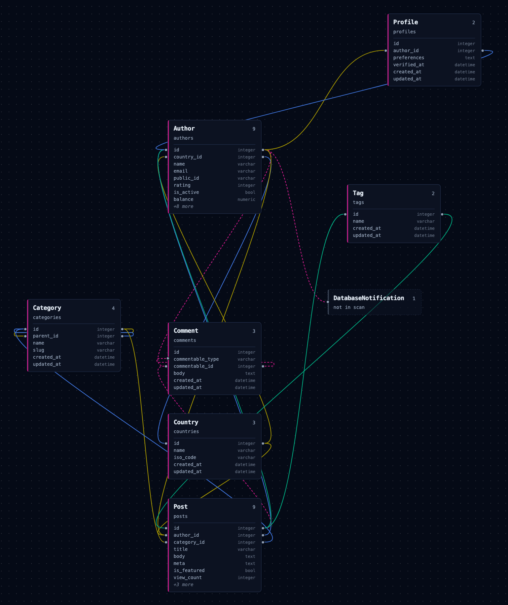
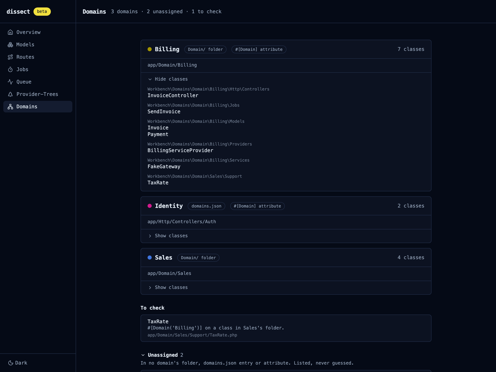

# 🩺 dissect

**Keep sight of your Laravel application, in the age of agentic development.**

dissect is a dev-only page inside your Laravel app that draws what your code
actually is: your models and how they relate, every endpoint and what it takes
and returns, every job and what dispatches it, what is on your queue right now,
what each service provider wires up, and which domain (bounded context) all of
it belongs to.

It reads your source and your framework's own metadata. It never runs your code
to find out. Everything it shows comes from what is in the repository right
now, so it stays correct while you, your team or your coding agents keep
changing things.



## 🤔 What it's for

Laravel apps grow sideways. A model gains a relation, a controller starts
queueing a job, a provider swaps an implementation, a "Billing" folder slowly
fills up with things that aren't billing. Each change is small and makes sense
in its diff. Nobody sees the whole picture, and when an agent writes half the
code, the picture moves faster than anybody can follow.

dissect gives you that picture with one `composer require`:

- 🧭 **Onboarding.** Open one page and see the schema, the HTTP surface and the
  background work. No grepping, no out-of-date diagram on a wiki.
- 🔍 **Reviewing.** Check after a change, yours or an agent's, that the
  relation points where you meant, the endpoint validates what you expected,
  and the job lands on the right queue.
- 🧱 **Architecture.** See which domain every class is in, spot the classes
  that sit in the wrong folder, and filter every list down to one domain.
- 🚑 **Debugging.** See what is waiting, running, delayed and failed on your
  queue, next to the code that put it there.

## ✨ What you get

The sidebar has one page for each question:

| Page | Answers |
| --- | --- |
| 🏠 **Overview** | How big is this app? Model, relation and view counts, plus a way into every other page. |
| 📦 **Models** | What does my data look like? Every Eloquent model with its columns, and each relation drawn between the columns that link it (`posts.author_id` → `authors.id`). |
| 🛣️ **Routes** | How is it reached? Every endpoint, its middleware, the request it validates and the response it returns. |
| ⏱️ **Jobs** | What happens in the background? Every job, queued listener, mailable and notification: its queue, retries, payload, and the endpoint that dispatches it. |
| 📡 **Queue** | What is happening *right now*? Waiting, running, delayed and failed jobs, plus batches. Live and polled. |
| 🌲 **Provider-Trees** | What is wired to what? Each service provider's bindings, what they resolve to, and the constructors behind them, drawn as a tree. |
| 🧭 **Domains** | How is this app split up? Every domain, how it was found, its classes, and anything that looks out of place. |

Each page has its own address (`/dissect#/routes`, `/dissect#/domains`, …), so
you can bookmark one or link a colleague to it.

And the parts that make it easy to live with:

- 📦 **No build step** in your app. The compiled frontend ships with the package.
- 🔌 **Nothing to publish.** The service provider is auto-discovered.
- 🔒 **Local-only by default**, behind a `viewDissect` gate everywhere else.
- 🤝 **Shared state you commit.** Node positions, saved views and hand-written
  domains live in `.dissect/` in your project, so your whole team sees the same
  picture.
- ♻️ **Live updates.** Edit a model, controller, job or provider and the page
  refreshes on its own, with no file watcher to run.
- 💻 **Works without the page too.** `php artisan dissect:export` prints any of
  it as JSON, a Markdown digest, or a Mermaid diagram of the models.
- 🚧 **Guardrails between domains.** Write down which domain may use which, and
  `php artisan dissect:check` fails CI when the code disagrees.
- 🤖 **An MCP server for agents.** `php artisan mcp:start dissect` answers
  questions about one model, route, job or provider at a time.

## 🚀 Quick start

dissect is not on Packagist yet, so install it straight from GitHub. From your
application's root:

```sh
composer config repositories.dissect vcs https://github.com/kadirtikil/dissect.git
composer require kdr-dev/dissect --dev
```

Then open **`/dissect`** in your local environment. That's it. 🎉

> 💡 Composer resolves packages by tag. To track the unreleased tip instead, or
> if no tag has been pushed yet, ask for the branch:
> `composer require kdr-dev/dissect:dev-main --dev`.
>
> 🔑 SSH works too: swap the URL for `git@github.com:kadirtikil/dissect.git`.

<details>
<summary>Adding the repository by hand instead</summary>

`composer config` writes the repository entry for you. To do it yourself, add
this to your application's `composer.json`:

```json
{
    "repositories": [
        { "type": "vcs", "url": "https://github.com/kadirtikil/dissect.git" }
    ]
}
```

Then run `composer require kdr-dev/dissect --dev`.

</details>

Publishing the config file is optional, since almost everything can be set from
`.env`:

```sh
php artisan vendor:publish --tag=dissect-config
```

### ✅ Requirements

- PHP 8.3+
- Laravel 13.x

Laravel 13 is a hard minimum, on purpose. Columns and relations come from the
framework's own `ModelInspector` (the class behind `artisan model:show`), and
the endpoint list reads [laravel-json-api](https://laraveljsonapi.io) schemas,
whose current release supports nothing earlier. Supporting one framework
version well is worth more here than supporting three thinly.

---

## 📦 Models

The graph is the heart of dissect. Every model in your models directory becomes
a card with its table and columns. Every relation becomes an edge from the
column that holds the key to the column it points at, so you read
`posts.author_id → authors.id`, not just "Post → Author".

- 🎨 **Relation families.** Eloquent's eleven relation types fold into four
  colours (has, belongs to, many-to-many, polymorphic), and polymorphic edges
  are dashed too, so colour is never the only signal. A legend is always on
  screen.
- 🔎 **Expand a card** to see every column with its key, unique, nullable,
  guarded, hidden and cast flags. From there, **Jobs** shows every job that
  carries this model.
- 👻 **Models outside the scan**, such as a vendor's `DatabaseNotification`,
  show as dashed "not in scan" placeholders instead of being dropped.
- ✋ **Drag cards** into an arrangement that makes sense. Positions are saved to
  `.dissect/layout.json`, which you commit, so the team gets the same layout.
  **Reset layout** puts everything back on the grid.

### 🗂️ Views

A large schema is easier to read one slice at a time. Pick the models you want
(shift-drag on the canvas, or tick them in the **View** menu's model list),
name the selection, and it is saved as a view in `.dissect/views.json`.

- ➕ Tick a model to add it to the open view, untick it to take it out. Changes
  save as you go.
- 🧭 A model keeps the same position in every view, so switching views hides
  models instead of rearranging the board.
- 🤝 The file is plain JSON and meant to be committed. Which view *you* have
  open is remembered per browser, not in the file.

### 📁 Models outside `app/Models`

One other directory is one variable:

```dotenv
DISSECT_MODELS_PATH=src/Domain
```

Models in several places, such as a Models folder per domain, go in the
published config. A `*` stands for one directory name:

```php
'models' => [
    'paths' => [
        'app/Domain/*/Models',
        'packages/billing/src/Models',
    ],
],
```

No namespace is needed, because each model's class name is read from its own
file. Two models with the same class name in different namespaces are two
cards. (`DISSECT_MODELS_NAMESPACE` is no longer read.)

---

## 🧭 Domains

If your app is split into domains (bounded contexts), dissect works out which
domain every class belongs to and shows the app through that lens. Most apps
need no configuration at all: domains are read from the folder layout you
already use.



### How domains are found

dissect recognises these layouts:

| Layout | Each domain is |
| --- | --- |
| [nwidart/laravel-modules](https://github.com/nWidart/laravel-modules) | `Modules/{Name}` |
| [InterNACHI/modular](https://github.com/InterNACHI/modular) | `app-modules/{name}` |
| Spatie's *Laravel Beyond CRUD* | `app/Domain/{Name}`, `src/Domain/{Name}` (or `Domains`) |
| Local packages | `packages/{name}` or `packages/{vendor}/{name}`, a folder with a `composer.json` |
| Hexagonal | `src/{Name}` or `app/{Name}` with at least two of `Domain/`, `Application/`, `Infrastructure/` |
| Layer-first sub-folders | `app/Models/{Name}` plus the same name under another layer, e.g. `app/Http/Controllers/{Name}` |

An app that follows none of these has no domains, and dissect looks exactly as
it does without them. A starter kit's `Auth` folders don't count as a domain,
which is why the layer-first rule needs a matching `app/Models/{Name}`.

### Writing domains down

For anything the folders don't express, list the domains in
`.dissect/domains.json`. Commit it, like the layout and the views:

```json
{
    "version": 1,
    "domains": [
        { "name": "Identity", "paths": ["app/Models/User.php", "app/Http/Controllers/Auth"] }
    ]
}
```

Paths are relative to the app root, a `*` stands for one directory name, and a
path may name a single file. Add `"conventions": false` to ignore the folder
layouts and use only this file.

### Moving a single class

A class that sits in the wrong folder can say where it belongs with an
attribute:

```php
#[Domain('Identity')]
class User extends Authenticatable {}
```

You declare the `Domain` attribute class yourself, in any namespace. dissect
matches it by its short name and reads it from the file without loading the
class, so nothing from this dev dependency ends up in your production code.

### Who wins

The attribute first, then `domains.json`, then the folder layout. A class none
of them claims is listed as **unassigned**. It is never guessed into a domain.

Two things are reported as **findings** so they get noticed instead of quietly
believed: an attribute that disagrees with the folder the class sits in, and an
attribute that names a domain nothing else defines.

### Where domains show up

- 🧭 **The Domains page** lists every domain with how it was found (folder,
  `domains.json`, attribute, …), its folders and its classes grouped by
  namespace, followed by the findings and the unassigned classes. An app with
  no domains gets an empty state that lists the layouts that would count.
- 🔗 **What each domain depends on, and what uses it.** Under each domain, one
  chip per other domain its classes name, and one per domain whose classes name
  its own, with how many references there are. A ⇄ marks two domains that name
  each other. Click a chip to see every reference behind it: which class, which
  class it names, how (relation, dispatch, type, …), and the file and line.
- 🏷️ **Every model, route, job and provider carries its domain**, so the other
  pages can use it. A route belongs to its controller's domain, and a closure
  route to the domain of the file it is written in. A provider belongs to the
  domain of its own class, not to what it binds.
- 🎛️ **Domain filters.** The Routes, Jobs and Provider-Trees lists show a row of
  domain chips under their other filters: one per domain that has rows in that
  list, plus **unassigned**. Click one to see just that domain's endpoints, jobs
  or providers. An app with no domains sees no chips.
- 🎨 **One colour per domain**, the same on every page, so Billing is
  recognisably Billing wherever it appears.
- 📄 **`/dissect/domains.json`** serves the same data as JSON, for scripts and
  agents.

### Which class uses which

dissect also reads every class, interface, trait and enum in your source
folders, and every other one of them it names. The Domains page uses it to
show how domains depend on each other. You can ask for it from the terminal or
an agent too:

```bash
php artisan dissect:export classes --format=md
```

```
## Between domains
- Billing → Sales: 1 (relation 1)
- Sales → Billing: 1 (relation 1)
```

Each reference says how one class names the other. Most kinds are what the
syntax says: `extends`, `implements`, `trait`, `new`, `static`, `type`,
`instanceof`, `catch` and `attribute`. Four are what the syntax means in a
Laravel app, which a generic dependency tool can't see:

- **`relation`**: `$this->belongsTo(Customer::class)` and the other relation
  builders.
- **`dispatch`**: `SendInvoice::dispatch()`, `dispatch(new SendInvoice)`, `Bus::dispatch(...)`.
- **`event`**: `event(new InvoicePaid)`, `Event::dispatch(...)`.
- **`binding`**: `$this->app->bind(Gateway::class, StripeGateway::class)`, and
  `when()->needs()->give()`.

Each name is counted once, with its most specific kind, so a dispatched job is
a `dispatch` and not also a `new`. Only references between your own classes
are listed. Everything is read as syntax, so nothing is loaded or run, and a
file that doesn't parse is listed as such rather than skipped silently.

### Boundary rules

Once you know which domain uses which, you can say which ones *may*. Add a
`rules` object to `.dissect/domains.json`, keyed by domain:

```json
{
    "version": 1,
    "rules": {
        "Billing": { "may_use": ["Shared"], "must_not_use": ["Illuminate\\Http"] },
        "Sales": { "may_use": ["Billing", "Shared"] }
    }
}
```

- **`may_use`** lists the other domains this one's classes may name. Anything
  else is a violation. Leave the key out to allow every domain, or give an
  empty list to allow none. A domain may always use itself, and a class in no
  domain is never a violation.
- **`must_not_use`** lists namespaces (or single classes) this domain must not
  name at all, the framework's and packages' included. `Illuminate\Http` keeps
  requests out of a domain layer.

A domain with no rule isn't checked, so you can start with one domain and add
the rest when they're ready. An app with no rules never builds the class index
for it. Every reference kind counts, the Laravel ones included: a relation, a
dispatched job or a container binding across a boundary is a violation like
any `new` or type hint.

A rule that can't be read, or that names a domain that doesn't exist, is
reported rather than ignored. A typo in an allow-list would otherwise be a
check that never fires.

```bash
php artisan dissect:export boundaries --format=md
```

```
2 rules, 1 violation.

## Sales (1)
- Sales may not use Billing: Customer → Invoice (relation, line 19). `app/Domain/Sales/Models/Customer.php:19`
```

#### Failing the build

`dissect:check` exits with 1 when a rule is broken, so CI or a pre-commit hook
can stop on it:

```bash
php artisan dissect:check
```

```
app/Domain/Sales/Models/Customer.php:19 Sales may not use Billing: Customer → Invoice (relation, line 19).

   ERROR  1 violation of 2 rules.
```

- **`--files=app/Domain/Sales/Models/Customer.php`** reports only what those
  files break. The whole app is still read, since whether a class may be named
  depends on which domain *it* is in, but you only hear about the files you
  gave it. Repeat the option or separate paths with commas.
- **`--format=github`** writes [workflow annotations](https://docs.github.com/en/actions/reference/workflow-commands-for-github-actions#setting-an-error-message),
  so a violation shows up on its line in the pull request.
- **`--format=json`** gives a script the verdict (`passed`) and everything
  behind it.

It also fails when `.dissect/domains.json` has a problem, such as invalid JSON,
an unknown key or a rule naming a domain that doesn't exist. Otherwise a broken
rules file would pass as "no rules". With no rules at all it passes and says
there was nothing to check. A file that doesn't parse is listed as not
checked, and doesn't fail on its own.

```yaml
# .github/workflows/ci.yml
- run: php artisan dissect:check --format=github
```

#### Catching an agent as it edits

`dissect:check --hook` runs as a Claude Code
[hook](https://code.claude.com/docs/en/hooks). After every Edit or Write it
checks the file that was just changed. When the edit breaks a rule, it tells
the agent at once, with the file, the line and the rule. Add this to
`.claude/settings.json` and commit it:

```json
{
    "hooks": {
        "PostToolUse": [
            {
                "matcher": "Edit|MultiEdit|Write",
                "hooks": [{ "type": "command", "command": "php artisan dissect:check --hook" }]
            }
        ]
    }
}
```

What the agent sees after an edit that breaks a rule:

```
dissect: this breaks a boundary rule in .dissect/domains.json:
- `app/Domain/Sales/Models/Customer.php:19` Sales may not use Billing: Customer → Invoice (relation, line 19).

The rule:
- **Sales** may use no other domain

Change the code so it keeps to the rule. The rule says where this team wants the boundary;
only change .dissect/domains.json if you were asked to move it.
```

- It stays silent when the edit keeps to the rules, and for any file that
  isn't PHP. An agent only hears from it when there's something to fix.
- Editing `.dissect/domains.json` itself checks the whole app, and a rules file
  that can't be read is reported whatever was edited.
- If the check can't run at all (the app doesn't boot, say), you see the error
  and the agent carries on. A broken tool never blocks an edit.
- The command is relative to the session's directory, so it checks the
  checkout the agent is working in, a git worktree included.

The [MCP server](#-for-agents-mcp) has the same check as `dissect_check`, for
an agent to ask before it edits rather than be told after.

> 🚧 **Coming next:** violations on the Domains page.

> 🚧 **Coming next: the domain map.** A graph with one node per domain and the
> dependencies between domains as edges, so you can see the shape of the whole
> app at the domain level and click through to the classes behind each
> dependency. It's being built now and will be documented here when it lands.

---

On the **Models** graph, each card names its domain beside the table, and its
left edge takes the domain's colour. A relation from a model in one domain to a
model in another is drawn thicker, and its label says which domain it goes
into (`invoices → Billing`). Relations to a model in no domain are not counted
as crossings.

Every domain is also a view in the view menu, under **Domains**. A domain view
shows that domain's models and follows its folders, so it can't be edited.
**Copy to a saved view** turns it into an ordinary view in
`.dissect/views.json`, which you can then change.

## 🛣️ Routes

The graph says what your data looks like. The **Routes** page says how you
reach it: every endpoint, what a request must carry, and what comes back.

```
POST api/invoices                      Request   StoreInvoiceRequest
auth:sanctum · throttle:60,1             customer_id  integer  req
                                           exists:customers,id
Response  resource · 201                 lines[].sku  string   req
  id          scalar
  customer    object  sometimes
  lines[]     array
```

- 🔀 **Web and API.** The list splits into the routes your own frontend calls
  and the API you offer to others, based on the middleware group each route
  file applies. An API served from somewhere other than `/api` still lands in
  the right half.
- 🌐 **Hosts.** Routes on different domains (hosts) are kept apart, and the host
  is shown before the path.
- 🔎 **Filter** by path, route name, controller or verb, and narrow by method,
  by domain, and by whose code it is (`app`, `vendor` or `framework`). A
  path-repository package counts as your own code.
- 👀 **Nothing is hidden.** Whatever you have selected elsewhere, the endpoint
  list shows every route until *you* filter it here.

### 🎯 Where the shapes come from

Requests are read from a `FormRequest`'s `rules()` when one is type-hinted, and
from an inline `$request->validate([…])` otherwise. Responses are read from the
return type and the `toArray()` of whatever `JsonResource` it names, nested
resources included.

Nothing in Laravel can be *asked* what an endpoint returns, so some of this is
read from your source rather than run. Each shape says which:

| Confidence | Meaning |
| --- | --- |
| `certain` | The framework produced it: `rules()` ran, or the resource declared its model with `@mixin`. |
| `inferred` | Read from the source. Usually `rules()` could not run outside a request, or the resource never said what it wraps. |
| `unknown` | The class was found but its shape could not be read. Treat it as incomplete. |

A confidently wrong API description is worse than none, so this is shown, not
smoothed over.

### 🧩 JSON:API

Apps built on [laravel-json-api](https://laraveljsonapi.io) get their shapes
from their **schemas**, since every route that package registers runs the same
generic controller and a return type would say nothing.

```
POST v1/documents                      Request   JSON:API document
                                         data          object  req
Response  JSON:API document  201           type        string  req
  data        object                       attributes  object
    type                                     title
    id                                       slug
    attributes  object                    relationships object
      title       sometimes                  owner       object
    relationships object                       data      object
```

- 📦 The **envelope** is shown, not the bare fields: you write
  `data.attributes.title`, so that is what the page says.
- 🔗 `posts/{post}/author` is described with the *author's* schema, and a
  `relationships/…` endpoint promises a type and an id and nothing else.
- 🚫 A `DELETE` says it answers `204` instead of reporting an empty body as a
  failure.
- ✅ Rules from the resource's `ResourceRequest` are shown where the value
  actually sits, at `data.attributes.title`.
- 🩹 Update fields stay optional, because a JSON:API update is a patch: the rules
  say what a value must look like *if you send it*.

---

## ⏱️ Jobs

The **Jobs** page answers the question a `202 Accepted` leaves behind: what
happens next, where, and carrying what. Jobs, queued listeners, mailables and
queued notifications all end up on the same worker, so they are all here,
found by the `ShouldQueue` interface instead of by which folder they sit in.

```
SendInvoice                            Queue     invoices
Job                                      set in the constructor
                                       Retries   3 tries · 10, 60s · 120s timeout
Payload                                Handling  batchable · after commit
  invoice   App\Models\Invoice
            carries Invoice            Dispatched by                          2
                                         InvoiceController@store  dispatch()
Carries                                  app/Http/…/InvoiceController.php:61
  Invoice ↗                              POST:api/invoices ↗
```

- 🔗 **Dispatched by** links to the endpoint that queues the job, and
  **Carries** jumps to the model on the graph.
- 🧭 **Grouped by queue**, because the queue is what you point a worker at.
- ⌀ **Never dispatched?** A job nothing dispatches is flagged: it is either
  dead code or dispatched dynamically. That's something `queue:work` can't tell
  you.
- 🔎 **Filter** by name, class, queue or dispatcher, and narrow by kind, queue
  and domain.

### 🎯 Where the queue name comes from

A job using Laravel's `Queueable` trait **cannot** declare a `public $queue`
property (PHP rejects the redefinition), so most jobs name their queue
somewhere else. dissect reads all of those places and says which one answered:

| Source | Meaning |
| --- | --- |
| `property` | A declared `$queue`. The usual form for a queued listener. |
| `constructor` | `$this->onQueue('…')` among the constructor's own statements. One inside an `if` doesn't count, since it depends on the arguments. |
| `dispatch` | The class named none, and exactly one dispatch site chained `->onQueue('…')`. |
| `mixed` | Two dispatch sites named two different queues. Picking one would invent a fact. |
| `default` | Nothing named one. |

Nothing is executed to find this out. `backoff()` and `middleware()` are read
from source too. Describing your code must never be able to break it.

---

## 📡 Queue

Every other page describes your code. This one describes your queue, right
now. It is polled every few seconds while open, never cached, and stops polling
when you leave the page or hide the browser tab.

```
database                         LISTENERS 1   MAIL 1   PUBLISHING 2

Now      Waiting   4    PublishPost      publishing   0/3   6m ago
         Reserved  1    PublishPost      publishing   1/3   taken 6m ago
Next     Delayed   2    PruneComments    maintenance  0/3   in 13m
Past     Failed    2    WeeklyDigest     mail         3/3   4h ago
                        TransportException: Connection refused
         Batches   2    Republish every post   86/120   2 failed   running
```

- 🔗 Every row links to its job class on the **Jobs** page.
- 🚦 The `database` and `redis` drivers can be listed. SQS, `sync`, `null` and a
  missing `jobs` table each say **why** they can't be, instead of showing an
  empty queue.
- 🔀 An app with several queue connections gets a switcher. Failed jobs are
  readable even when the queue itself is not.
- 🔢 Counts are always exact. A queue 40,000 deep reports 40,000 and lists the
  first page.

> 🕳️ **Laravel keeps no record of a job that succeeded.** It is queued, it runs,
> it is deleted. So the history here means *what failed* and *what was
> batched*, and an empty history means nothing failed, not that nothing ran.
> That gap is why Horizon exists.

> 🔒 **Payloads are never unserialised.** The queue payload holds a serialised
> instance of your job. Unserialising it would construct your objects, run
> their `__wakeup`, and load every model a `SerializesModels` job carries.
> dissect reads only the JSON envelope, and the payload is never put on the
> page.

---

## 🌲 Provider-Trees

The **Provider-Trees** page reads each of your service providers and draws what
it decides: the contracts it binds, what they resolve to, and, following
constructor type-hints, what those classes need in turn.

```
DocumentServiceProvider ── singleton ──▶ TextExtractor ── singleton ──▶ TikaTextExtractor
        │                                                                     │ injects
        ├── bind ────────▶ ImageRenderer ── bind ──▶ ImagickRenderer          ▼
        │                        │                                      VersionStore
        └── contextual ──────────┘── contextual · when RenderThumbnail ──▶ VipsImageRenderer
```

- 🧩 Contracts and the classes they resolve to are separate boxes. What
  somebody asks for versus what they get is the whole point of a binding.
- 🎯 `when()->needs()->give()` is drawn next to the default it overrides,
  labelled with who is asking.
- 🔗 A provider that registers another continues into that provider's bindings.
- 🏷️ Side effects (events, gates, config, publishes, migrations, routes, views,
  commands) are counted as badges on the provider, so they don't bury the
  dependencies.
- 〰️ Line style says how sure it is: solid for what is written literally,
  dashed for what a constructor implied, dotted for what couldn't be read.
- 🔎 Search matches a class anywhere in any tree, so "which provider wires up
  the transcoder?" is one word. Narrow by domain with the chips.

### 🕳️ What it cannot see

Nothing is booted to find this out, since registering a provider would connect
whatever its singletons connect to. So only what is written literally can be
named. A binding built in a loop, a class name in a variable, or a binding
inside a helper method shows up as a dotted "unresolved" box with the code as
written, under a banner saying the tree is not fully analysed. A tree cut short
by `max_depth` or `max_nodes` says so too.

The walk stops at framework and package code: `Illuminate\Filesystem\Filesystem`
gets a box, but its constructor isn't followed. A contract your provider
type-hints but doesn't bind is a leaf, because some other provider decides it.

Only your own providers are listed. The ones in `bootstrap/providers.php` and
those packages register run into the hundreds and are almost all vendor code.

---

## 💻 From the terminal

Everything the page shows can be printed without opening it. That's useful for
a script, for a CI step, and for handing an agent a map of the app.

```bash
php artisan dissect:export                                # every surface, as JSON
php artisan dissect:export routes                         # one surface
php artisan dissect:export classes --format=md            # which class uses which
php artisan dissect:export boundaries --format=md         # where a domain breaks its rule
php artisan dissect:export jobs --format=md               # a digest to read
php artisan dissect:export schema --format=mermaid        # the models as an ER diagram
php artisan dissect:export --format=md --output=docs/app.md
php artisan dissect:check                                 # exit 1 if a domain breaks its rule
```

- **`json`** is exactly the payload the page reads (see the endpoints under
  [How it works](#-how-it-works)), so anything built on one works on the other.
- **`md`** is a digest of the same payload: one line per model, route, job or
  binding, with the details people look them up for underneath. It comes out
  at about a tenth the size of the JSON, which matters when it goes into a
  prompt. Anything dissect only inferred is marked as inferred, and a
  long field list ends in `+N more` instead of stopping silently.
- **`mermaid`** draws the models as an `erDiagram`, which GitHub, GitLab and
  most docs sites render as-is. Keys are marked `PK`, `FK` and `UK`, and a
  relation and its inverse are one line named by both ends (`invoices /
  customer`). It's for the schema only.

```
- `POST api/documents` documents.store → DocumentController@store · api
  - middleware: api, auth:sanctum
  - request (form-request StoreDocumentRequest): title* string; document_type_id* integer; tags[].name* string
  - response 201 (resource DocumentResource): id; title
```

The command works whether or not the page is enabled. It only reads your code,
and an Artisan command can't be reached from the web, so it doesn't need the
`dissect.enabled` switch or the `viewDissect` gate. The queue isn't exported:
it's runtime state, and a file of it would be stale before anyone opened it.

---

## 🤖 For agents (MCP)

dissect ships an [MCP](https://modelcontextprotocol.io) server, so a coding agent
can ask about the one model or route it's working on instead of reading the
whole app into its context. It's built on the official
[laravel/mcp](https://github.com/laravel/mcp) package and registered for you as
a local server:

```bash
php artisan mcp:start dissect
```

To add it to Claude Code, run this from your project root:

```bash
claude mcp add dissect -- php artisan mcp:start dissect
```

Or commit it for the team in `.mcp.json` at the project root, which other MCP
clients read too:

```json
{
  "mcpServers": {
    "dissect": {
      "command": "php",
      "args": ["artisan", "mcp:start", "dissect"]
    }
  }
}
```

| Tool | Answers |
| --- | --- |
| `dissect_search` | Where does a name appear? Models, tables, columns, routes, request fields, jobs, classes anywhere in a provider tree, domains. |
| `dissect_model` | A model's table, columns, relations with their key columns, and who points at it. |
| `dissect_route` | A route's action, middleware, request fields and response shape, found by name, URI, verb and URI, or controller. |
| `dissect_job` | A queued class's queue, retries, payload, and every place that dispatches it. |
| `dissect_provider` | What a provider binds, what that resolves to, and what those classes need. |
| `dissect_domain` | The domains, or every class in one. |
| `dissect_class` | What a class uses and what uses it, by kind and line, with crossings between domains marked. |
| `dissect_check` | Whether the code keeps to the boundary rules, for the files given or the whole app, with every violation and the rule it breaks. |

Every tool is read-only and answers in the same Markdown as
`dissect:export --format=md`. Called with no name, a tool lists everything in
one line each; with a name, short (`Invoice`) or full, it gives the entry. An
exact name beats a partial one.

Each call reads the app fresh through `dissect:export`, so an answer reflects
the code as it is now, not as it was when the agent's session started. (A
long-running PHP process can't forget a class it has already loaded, so asking
in-process would keep serving a model's old relations after you edit it.) The
exporters' caches keep that fast when nothing has changed.

Like the export command, the server is a local process and doesn't depend on
`dissect.enabled` or the `viewDissect` gate. It's never served over HTTP.

---

## 🤝 Files you commit

dissect keeps the things people author in a `.dissect/` folder at your project
root. It's deliberately not in `storage/` (gitignored) or `vendor/` (wiped by
`composer install`): these are worth agreeing on once and reviewing in a pull
request.

| File | Written by | Holds |
| --- | --- | --- |
| `.dissect/layout.json` | the page, when you drag a card | Where each model sits on the graph. |
| `.dissect/views.json` | the page, when you save a view | Named subsets of the graph. |
| `.dissect/domains.json` | you, by hand | Domains the folder layout doesn't express, and the boundary rules between them. Never written by dissect. |

### 🧷 Upgrades and your files

`composer update` can't touch these files. Each one records the format version
it was written in, and dissect won't rewrite a file written by a **newer**
version than the one you're running. It reads it, renders what it understands,
and refuses the save with a message, instead of replacing your layout with the
subset it recognised. So "layout not saved" on a machine with an older dissect
is a version mismatch, not a bug.

When a release changes the format, your file is copied to
`.dissect/layout.json.v1.bak` before the first migrating write. An unparseable
file is copied to `.dissect/layout.json.corrupt.bak` (then `.corrupt.2.bak` and
so on) before being replaced, so no broken hand edit is lost.

Format 2 identifies models by full class name (`App\Models\Invoice`) instead of
short name. Older files are upgraded automatically. A short name that two
models share stays in a view as both, and loses its position in the layout,
since there's no telling which one was dragged there.

---

## ⚙️ Configuration

Most settings can be changed through environment variables, so you rarely need
the published config file.

| Variable | Default | Purpose |
| --- | --- | --- |
| `DISSECT_ENABLED` | unset | Unset means "on in `local` only". Set `true` or `false` to decide explicitly. |
| `DISSECT_PATH` | `dissect` | URL prefix the page is served from. |
| `DISSECT_MODELS_PATH` | `app/Models` | Directory scanned for models. Relative paths resolve from the base path. For several directories, use `models.paths`. |
| `DISSECT_DOMAINS` | `true` | `false` turns domain detection off entirely. |

The rest live in `config/dissect.php`:

<details>
<summary><b>General</b></summary>

- **`middleware`**: default `['web']`. Add your auth middleware here if you
  enable the page outside local. The `viewDissect` gate check is always added
  after this list.
- **`layout_path`**: default `base_path('.dissect/layout.json')`.
- **`views_path`**: default `base_path('.dissect/views.json')`.

</details>

<details>
<summary><b>Models</b></summary>

- **`models.paths`**: default `[]`, which means "use `models_path`". A list of
  directories holding models, where `*` stands for one directory name.

</details>

<details>
<summary><b>Domains</b></summary>

- **`domains.file`**: default `base_path('.dissect/domains.json')`. Domains
  written down by hand.
- **`domains.root`**: default `base_path()`. Where folder layouts are looked for.
- **`domains.paths`**: default `['app', 'src', 'Modules', 'app-modules', 'packages']`.
  Where classes are looked for when listing every domain's members. Each
  domain's own folders are always included.

</details>

<details>
<summary><b>Routes</b></summary>

- **`routes.watch_paths`**: default `['app', 'routes']`. Directories watched to
  notice the endpoint list has changed. Narrow it to where your HTTP code lives
  if `app/` is large.

</details>

<details>
<summary><b>Jobs</b></summary>

- **`jobs.paths`**: default `['app/Jobs', 'app/Listeners', 'app/Mail', 'app/Notifications']`.
  Where queueable classes are looked for. Each class name is read from its own
  file, so an unusual layout just needs its directory added.
- **`jobs.watch_paths`**: default `['app', 'routes']`. Where dispatch sites are
  looked for. This is the widest scan dissect does (every file is parsed), so
  narrowing it helps most here.

</details>

<details>
<summary><b>Providers</b></summary>

- **`providers.paths`**: default `['app/Providers']`. Any concrete
  `ServiceProvider` subclass in here counts.
- **`providers.max_depth`**: default `4`. How many constructor hops a tree
  follows before it stops and says so.
- **`providers.max_nodes`**: default `150`. A hard cap per tree, to bound the
  cost on a large app.
- **`providers.watch_paths`**: default `['app']`. Wider than `providers.paths`
  on purpose: a tree changes when any constructor down it does.

</details>

<details>
<summary><b>Queue</b></summary>

- **`queue.rows`**: default `50`. How many jobs each section lists. Counts are
  always exact.
- **`queue.poll_interval`**: default `5000` (ms). How often the Queue page
  re-reads while it is open.

</details>

---

## 🔐 Security: what keeps this off production

It's easy to assume more protection than there is, so here's exactly how it
works. The service provider is auto-discovered and boots on **every request in
every environment** where the package is installed. One check decides whether
the routes register:

```php
config('dissect.enabled') === null
    ? app()->environment('local')   // the default
    : (bool) config('dissect.enabled');
```

So the switch is **`APP_ENV`**, and two things have to hold that dissect can't
enforce:

1. Production deploys with `composer install --no-dev`, so a `--dev` install
   isn't there at all.
2. `APP_ENV` isn't `local` there, and nobody left `DISSECT_ENABLED=true` on
   after debugging.

Break either (a staging box left at `APP_ENV=local`, a deploy that installs dev
dependencies) and the routes are live. That's why registering them isn't the
same as letting anybody in.

**Outside `local`, every dissect route checks the `viewDissect` gate**, the way
Telescope checks `viewTelescope`. No gate defined means a 403. The check is
added after your `middleware` list, so editing that list can't remove it. To use
dissect on staging, enable it and say who may see it, for example in
`AppServiceProvider::boot()`:

```php
use Illuminate\Support\Facades\Gate;

Gate::define('viewDissect', fn ($user) => in_array($user->email, [
    'you@example.com',
]));
```

Give the closure a nullable user (`fn (?User $user = null) => …`) if the box is
already behind a VPN or basic auth and guests should get in.

Anyone who passes the gate sees:

- your full schema, every route, every validation rule, every job, every
  provider and every domain;
- **what is on your queues right now**: which jobs, on which queue, with their
  attempts and timings (never their arguments);
- **failed jobs, including the first line of each exception**. SQL is cut out
  of database errors, but other exception messages are shown as written, and
  apps do put user data in those;
- two POST endpoints that write `.dissect/layout.json` and `.dissect/views.json`
  into your project root.

---

## 🔍 How it works

- **Read, never run.** Models come from Laravel's `ModelInspector`, routes from
  the router, and everything else (request and response shapes, dispatch sites,
  queue names, provider bindings, `#[Domain]` attributes) is parsed from your
  source with [nikic/php-parser](https://github.com/nikic/PHP-Parser) or read by
  reflection. No job is constructed, no provider is booted, no container
  binding is resolved.
- **Cached against fingerprints.** Each surface caches its result against a
  fingerprint of the files it depends on, so the expensive work runs once per
  change, not once per request. Editing `.dissect/domains.json` invalidates the
  surfaces that carry a domain.
- **Fast first paint.** The schema, layout and views are inlined into the
  initial HTML, so the page makes no requests on boot. Routes, jobs, providers
  and domains are fetched the first time you open their page.
- **Live by polling.** The page polls those fingerprints, so editing a model, a
  controller, a dispatch or a constructor refreshes the right page without a
  file watcher.
- **The queue is the exception.** It's runtime state, not source, so it's never
  cached and is polled only while its page is open.
- **Assets** are served from the package's `dist/` by a route with an
  allow-list, so there's nothing to publish or re-publish after an upgrade.

Every page is backed by a JSON endpoint under your `DISSECT_PATH`, and every
one but the queue can also be printed with
[`dissect:export`](#-from-the-terminal):

| Endpoint | Contents |
| --- | --- |
| `/dissect/schema.json` | Models, columns and relations. |
| `/dissect/routes.json` | Endpoints with request and response shapes. |
| `/dissect/jobs.json` | Queueables, their queues and dispatch sites. |
| `/dissect/providers.json` | Provider trees. |
| `/dissect/domains.json` | Domains, their classes, findings and unassigned classes. |
| `/dissect/classes.json` | Every class and the app classes it uses. |
| `/dissect/boundaries.json` | The boundary rules, what's wrong with them, and every violation. |
| `/dissect/queue.json` | The live queue. |

See [ARCHITECTURE.md](ARCHITECTURE.md) for the full design and every payload
format.

## 🗺️ Roadmap

- 🧭 **Domain map.** Domains as nodes and the dependencies between them as
  edges. In progress.
- 📜 **OpenAPI export** from the route shapes dissect already reads.
- ✅ **Contract compliance**: checking that endpoints return what they promise.

## 🛠️ Contributing

The package is developed against
[Orchestra Testbench](https://packages.tools/testbench), with a Workbench
application in `workbench/`.

```sh
composer install
pnpm install

composer serve      # build the workbench app and serve it
composer test       # PHPUnit
pnpm test:unit      # Vitest
pnpm test:e2e       # Playwright
pnpm build          # type-check and compile the frontend into dist/
pnpm lint           # oxlint + eslint
```

### 🧪 Fixtures

- **`workbench/app`** is small on purpose. It covers every relation family and
  column kind, a form request whose `rules()` can't run, a resource with no
  model behind it, a closure route and an invokable controller. The tests
  assert against it. It has no domains, to prove an app without them is left
  alone.
- **`workbench/domains`** is a second app that *does* have domains: Billing and
  Sales under `app/Domain`, an Identity domain built from a `domains.json`
  entry and a `#[Domain]` attribute, a stale attribute that disagrees with its
  folder, and a class no domain claims.

  ```sh
  touch .workbench-domains   # serve the domain fixture instead
  composer serve
  rm .workbench-domains      # back to the plain app
  ```

- **`composer serve:huge`** generates a 122-model schema, to see what layout,
  the minimap and saved views do under load. `composer huge:clean` removes it.

### ⚡ Frontend hot reload

Run `composer serve:hmr` in one terminal and `pnpm dev` in another. You get the
real Laravel host with the frontend served from Vite, so frontend edits
hot-reload while the PHP side stays real.

### 🏷️ Releasing

`dist/` is committed on purpose. It's the compiled bundle the Composer package
serves, and the whole promise is one `composer require` with no build step in
your app. So **every release must rebuild it**:

```sh
pnpm build
git add dist && git commit -m "build: dist for vX.Y.Z"
git tag vX.Y.Z && git push --tags
```

⚠️ A tag that ships a stale `dist/` ships a stale UI to everyone who installs it.

## 📄 License

MIT. See [LICENSE](LICENSE).
